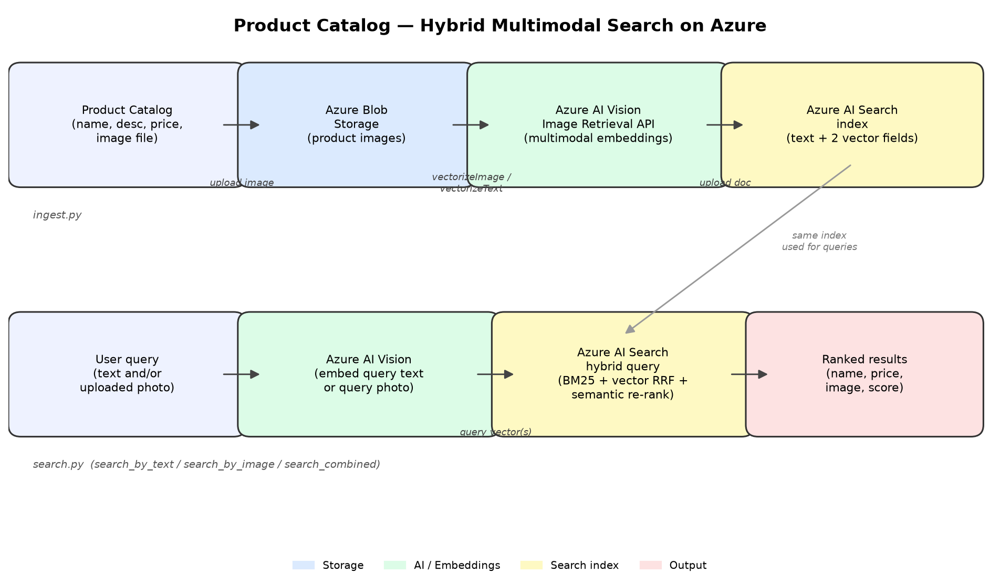

# Product Catalog — Hybrid Multimodal Search on Azure

[](https://github.com/FairyFox5700/product-catalog-hybrid-multimodal-search/actions/workflows/ci.yml)
[](LICENSE)

An end-to-end implementation of a product catalog search system using the Azure AI
("Cognitive Services") stack:

- **Azure Blob Storage** — stores the product images.
- **Azure AI Vision (Image Retrieval API)** — generates multimodal embeddings. Both
  product images and free-text queries are projected into the *same* vector space,
  enabling true cross-modal search (type a description, get back matching photos;
  or upload a photo, get back visually similar products).
- **Azure AI Search** — a hybrid index combining classic BM25 full-text search,
  vector (HNSW/cosine) similarity search over two vector fields (`text_vector`,
  `image_vector`), and L2 semantic re-ranking — fused automatically via
  Reciprocal Rank Fusion (RRF) when both a keyword query and vector queries are
  supplied in the same request.

## Architecture



## Demo

A Streamlit UI (`app.py`) lets you try all three query modes interactively —
text search, reverse image search, and combined text+photo search — with live
thumbnails, price/stock badges, and relevance scores:

```powershell
streamlit run app.py
```

## Project layout

```
product-catalog-search/
├── requirements.txt
├── requirements-dev.txt          # pytest, ruff
├── .env.example                  # copy to .env and fill in your Azure resource values
├── catalog.sample.json           # sample catalog metadata (name/desc/price/image path)
├── app.py                        # Streamlit demo UI (text / image / combined search)
├── .github/workflows/ci.yml      # lint + byte-compile + pytest on every push/PR
├── docs/
│   ├── architecture.png          # architecture diagram (rendered by make_diagram.py)
│   └── make_diagram.py           # script that generates architecture.png
├── tests/                        # pytest suite — Azure SDK/HTTP calls are mocked
│   ├── conftest.py
│   ├── test_config.py
│   ├── test_embeddings.py
│   ├── test_image_store.py
│   ├── test_create_index.py
│   ├── test_ingest.py
│   └── test_search.py
└── catalog_search/
    ├── config.py                 # loads settings from environment / .env
    ├── embeddings.py             # Azure AI Vision multimodal embedding client
    ├── image_store.py            # Azure Blob Storage upload + SAS URL helper
    ├── create_index.py           # defines & creates the Azure AI Search index
    ├── ingest.py                 # uploads images, embeds, indexes catalog items
    └── search.py                 # hybrid + multimodal query functions
```

## Testing & CI

The full test suite mocks every Azure SDK/HTTP call (`unittest.mock`), so it
runs without any live Azure resources, credentials, or network access:

```powershell
pip install -r requirements.txt -r requirements-dev.txt
pytest -v
ruff check .
```

GitHub Actions (`.github/workflows/ci.yml`) runs lint + byte-compile + the full
test suite on Python 3.11 and 3.12 for every push and pull request to `main`.

## Prerequisites (Azure resources)

1. **Azure AI Search** service (Basic tier or higher — semantic ranking requires a
   billable tier; vector search works on Free/Basic too).
2. **Azure Storage account** with a blob container for product images.
3. **Azure AI Vision** resource (Computer Vision / "Azure AI services" multi-service
   resource) in a region that supports the Image Retrieval API (e.g. East US,
   France Central, Korea Central, North Europe, Southeast Asia, West Europe, West US).

## Setup

```powershell
cd product-catalog-search
pip install -r requirements.txt
Copy-Item .env.example .env
notepad .env   # fill in endpoints + keys (or leave keys blank to use az login / Managed Identity)
```

## Usage

```powershell
# 1. Create (or update) the search index schema
python -m catalog_search.create_index

# 2. Ingest the sample catalog (uploads images, computes embeddings, indexes docs)
python -m catalog_search.ingest catalog.sample.json

# 3. Run a hybrid text query (keyword + cross-modal vector + semantic re-ranking)
python -m catalog_search.search "warm waterproof winter coat"
```

Programmatic usage:

```python
from catalog_search.search import search_by_text, search_by_image, search_combined

# Keyword + cross-modal vector hybrid search
results = search_by_text("red leather shoes", top=10, filter_expr="in_stock eq true")

# "Find similar products" from a photo the user uploaded
with open("uploaded_photo.jpg", "rb") as f:
    results = search_by_image(f.read(), top=10)

# Combined: typed refinement + reference photo
with open("uploaded_photo.jpg", "rb") as f:
    results = search_combined(text="but in blue", image_bytes=f.read(), top=10)
```

## How hybrid + multimodal search works here

- **Hybrid** = one Azure AI Search request carries both `search_text` (BM25 keyword
  scoring across `name`/`description`/`category`/`brand`) *and* one or more
  `vector_queries` (ANN similarity over `text_vector` / `image_vector`). Azure AI
  Search fuses the two ranked lists with Reciprocal Rank Fusion automatically, and
  optionally applies semantic (L2) re-ranking on top for natural-language queries.
- **Multimodal** = the embedding model (Azure AI Vision's Florence-based Image
  Retrieval API) maps images and text into one shared vector space. Storing each
  product's `image_vector` lets a *text* query embedding retrieve the most visually
  relevant photos without any manual tagging, and lets an uploaded *photo* retrieve
  textually similar catalog entries — the core of multimodal product search.

## Security notes

- Prefer `DefaultAzureCredential` (Managed Identity / `az login`) over API keys in
  production; every client here falls back to AAD auth automatically when no key is
  configured in `.env`.
- Image URLs handed to the Vision API and returned to clients are short-lived SAS
  URLs, not permanently public blobs.
